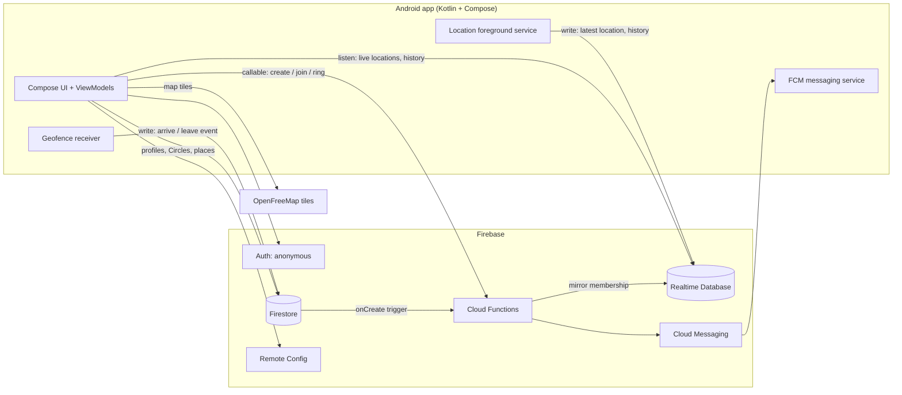

# Circle Tracker (working title): Project & Development Plan

**Type:** Free, personal-use Android app for real-time location sharing inside small private groups ("Circles")
**Stack:** Kotlin + Jetpack Compose, Firebase (Auth, Realtime Database, Firestore, Functions, FCM), MapLibre + OpenStreetMap
**Plan date:** 2026-11-23 · **Assumed pace:** solo, about 10 hours/week → about 12 weeks to v1.0
**Status:** Draft v1 (Firebase project and GitHub repo already exist)

---

## 1. Decisions and assumptions

### Confirmed decisions

| Area | Decision |
|---|---|
| Platform / language | Android only, Kotlin, Jetpack Compose |
| Map | MapLibre Native (Android) with OpenStreetMap-based vector tiles |
| Design | Material 3 with dynamic color, light and dark mode, English + Bahasa Indonesia |
| Audience | Families, friend groups, couples; fewer than 20 users; personal project |
| Auth | Firebase Anonymous Auth, joining Circles with an invite (share) code, PIN-based recovery |
| Firebase plan | Blaze (pay-as-you-go) with a hard budget alert, staying inside no-cost quotas |
| Databases | Realtime Database for live location and history; Firestore for profiles, Circles, places, events |
| MVP scope | Create/join Circle by code · live location in a foreground service · member map (avatar, battery, last updated) · short history · place alerts (arrive/leave) via push · "ring my phone" + last-known location |

### Assumptions to confirm (change them and the plan adapts)

1. **PIN = optional recovery PIN.** Anonymous accounts are lost on reinstall or data clear, so a PIN + Recovery ID lets a person reclaim their identity on a new phone. If you meant a per-Circle PIN needed to join (in addition to the code), it is a small change to `joinCircle` (section 7).
2. **One identity can sign in on several devices** through the recovery flow, so devices are modelled separately (`users/{uid}/devices/{deviceId}`).
3. **Distribution** is a sideloaded APK or Firebase App Distribution (no Google Play fee).
4. **Regions** were already chosen when you created the Firebase project. Database locations can't be changed later, so confirm them (Realtime Database has an Asia region in Singapore).
5. **Avatars** are emoji or initials on a color, with no photo upload, so Cloud Storage is not needed.

---

## 2. Goals, non-goals, principles

**Goals**
- Reliable live location among 2–20 trusted people, battery-aware.
- Free to run: stay inside Firebase no-cost quotas (see section 5).
- Simple enough to finish solo in about 12 weeks.

**Non-goals (v1)**
- iOS, web viewer, Bluetooth/UWB tag finding, crowdsourced offline finding, crash detection, driving reports, SOS dispatch, temporary public share links.

**Privacy and safety principles (non-negotiable)**
- Sharing is consent-based and always visible: a persistent notification while sharing, a pause control, and a per-Circle sharing toggle.
- No "hidden mode", no hidden app icon, no silent install.
- Leaving or being removed from a Circle immediately revokes access and deletes that person's location and history for the Circle.
- Ringing someone's phone is allowed only if they enabled it, and they get a notification each time.
- No analytics SDKs that profile users; Crashlytics only.

---

## 3. Features

| # | Feature | Priority | Phase |
|---|---|---|---|
| F1 | Anonymous sign-in, profile (name, emoji/color avatar) | MVP | 1 |
| F2 | Create Circle, invite code (expiring, revocable), join by code, leave/remove member | MVP | 1 |
| F3 | Live location sharing via foreground service, adaptive intervals, pause/stop | MVP | 2 |
| F4 | Member map: markers, bottom sheet with battery, last updated, stale state | MVP | 2 |
| F5 | Short location history (default 24 h) with route on map | MVP | 3 |
| F6 | Last-known location when a member is offline | MVP | 3 |
| F7 | Places (home, school, work) and arrive/leave push alerts | MVP | 4 |
| F8 | "Ring my phone" (target device plays alarm), with consent and log | MVP | 5 |
| F9 | Recovery ID + PIN to restore identity / add a second device | Should | 6 |
| F10 | Live boost (viewer opening the map temporarily raises update rate) | Could | 6 |
| F11 | Place label on member ("At Home") computed on-device | Could | 4 |

---

## 4. Tech stack

| Layer | Choice | Notes |
|---|---|---|
| Language / UI | Kotlin, Jetpack Compose, Material 3 | Dynamic color on Android 12+, static fallback below |
| Architecture | MVVM + unidirectional data flow (ViewModel + StateFlow) | Repository layer wraps all Firebase access |
| DI | Hilt | Koin is fine if you prefer less ceremony |
| Async | Kotlin Coroutines + Flow | Wrap Firebase listeners in `callbackFlow` |
| Navigation | Navigation Compose | Type-safe routes |
| Maps | MapLibre Native Android | `org.maplibre.gl:android-sdk` from Maven Central; wrap in `AndroidView` or use a community Compose wrapper |
| Tiles / style | OpenFreeMap style URL, kept in Remote Config | Lets you swap tile provider without a release; re-check provider terms |
| Location | Play Services Fused Location Provider + Geofencing API | Phones without Google Play services are unsupported |
| Firebase (client) | BoM-managed: Auth, Realtime Database, Firestore, Messaging, Remote Config, Crashlytics, App Check | Do not pin versions by hand; use the BoM |
| Firebase (server) | Cloud Functions 2nd gen, TypeScript | Needs Blaze plan |
| Local storage | Jetpack DataStore | Settings, onboarding state, device ID |
| i18n | `values/` (English) + `values-in/` (Indonesian) | Per-app language via AppCompat locales |
| Testing | JUnit, MockK, Turbine, Compose UI tests, Firebase Emulator Suite, rules unit tests | Emulators work without a billing account |
| Quality | ktlint or detekt, Android Lint | Run in CI |
| Min / target SDK | minSdk 26, target latest stable API | Dynamic color needs API 31+, falls back gracefully |

---

## 5. Firebase setup and cost model

### 5.1 Plan and limits (verified 2026-11-23 against Firebase docs; re-check before release)

| Product | Spark (no billing) | Blaze | Why it matters here |
|---|---|---|---|
| Realtime Database | 1 GB stored, 10 GB/month download, **100 simultaneous connections** | Same no-cost quota, then pay-as-you-go; 200K connections | Live location goes here. Metered by bandwidth and storage, not per write |
| Firestore (standard) | 1 GiB, 50K reads/day, 20K writes/day, 20K deletes/day | Same daily quota, then pay-as-you-go | Fine for profiles/Circles/places/events; **not** for location pings |
| Cloud Functions | **Not available** | 2M invocations, 400K GB-s, 200K CPU-s, 5 GB egress per month no-cost | Required for join validation, push fan-out, ring |
| FCM, Anonymous Auth | No-cost | No-cost | |

Notes:
- On Spark, exceeding a no-cost quota shuts that product off for the rest of the month. On Blaze you are billed for overage instead.
- Blaze is mandatory because Cloud Functions requires it. You may be eligible for Google Cloud's $300 credit.
- Deploying functions uses Cloud Build and Artifact Registry (first 500 MB free). Expect pennies at most.

### 5.2 Guardrails (do these in Phase 0)

- Create a **budget alert** (for example at a few USD) in Google Cloud Billing. Alerts only notify; they do not stop spend.
- Set `maxInstances` on every function (start at 3) and keep memory small.
- Add a **kill switch** in Remote Config (`sharing_enabled`) that the app reads at startup.
- Keep secrets (service-account keys, keystores) out of git; add `google-services.json` to `.gitignore` if the repo is public and keep a `google-services.json.example`.

### 5.3 Sizing (my estimates, assumptions in bold)

Assumptions: **20 users in one Circle**, about **250 bytes per location event on the wire**, each phone writes every 15 s while moving (**2 h/day**) and every 5 min otherwise, map visible on each phone **30 min/day**.

| Metric | Estimate | Free quota |
|---|---|---|
| RTDB writes | about 15K/day (not billed per write) | n/a |
| RTDB download | about 75 MB/month | 10 GB/month |
| Firestore reads | about 6K/day | 50K/day |
| Firestore writes | under 100/day | 20K/day |
| Function invocations | hundreds/month | 2M/month |

**Worst case**: everyone watching everyone 24/7 at 15 s updates is about 16 GB/month of RTDB download, which exceeds the 10 GB free quota. Hence the rules below:
- Attach location listeners **only while the map screen is visible**, never in the foreground service.
- Write only when the person moved more than 15 m or the heartbeat interval passed.
- Do **not** trigger a Cloud Function on location writes (that would be about 100K+ invocations/day).

---

## 6. Architecture



### Key flows

**Location pipeline**
1. User taps *Start sharing* (app visible) → `LocationForegroundService` starts with `foregroundServiceType="location"` and an ongoing notification (Pause / Stop actions).
2. Fused Location Provider with adaptive requests:
   - **Moving** (speed above about 1 m/s or activity recognition): high accuracy, 10–15 s.
   - **Stationary**: balanced power, 5 min heartbeat.
   - **Live boost** (F10): 5 s for 2 min.
3. Each fix → one multi-path `updateChildren` writing `locations/{circleId}/{uid}` for every Circle with sharing on; also append to `history/...` when the person moved at least 50 m or 60 s passed.
4. Battery level and charging state ride along in the same payload.

**Place alerts**
1. Places are stored in Firestore; each phone registers them with the Geofencing API (up to 100 per app per user, so cap at 20 per Circle).
2. On ENTER/EXIT the receiver writes `circles/{id}/events/{eventId}`.
3. Function `onPlaceEventCreated` validates, de-duplicates (same user, place, type within 5 min), and sends an FCM **data** message to other members' devices. The receiving app builds the notification text in the recipient's language.

**Ring my phone**
1. Caller invokes callable `ringDevice(circleId, targetUid, deviceId)`.
2. Function checks both are members and the target has `allowRing = true`, then sends a high-priority FCM data message with a short TTL (about 30 s) so stale rings don't fire later.
3. Target runs `RingService` (alarm stream, max volume, notification with *Stop*) and logs a "rang your phone" event. Spike this early, since background-start rules for audio services depend on API level.

**Identity**
- Anonymous Auth gives a `uid` per install. Circle membership is by `uid`.
- Recovery (F9): setting a PIN creates a short Recovery ID. `recoverIdentity(recoveryId, pin)` verifies a salted hash, enforces lockout, then returns a custom token for the **same uid**.

---

## 7. Data model

### 7.1 Realtime Database (live data)

```text
/circleMembers/{circleId}/{uid}            { role, joinedAt }     // mirror, written only by Functions
/locations/{circleId}/{uid}                latest location        // written by that user only
/history/{circleId}/{uid}/{pointId}        { lat, lng, t, acc }   // append by that user, pruned daily
/liveRequests/{circleId}/{uid}             timestamp              // optional (F10)
```

`/circleMembers` exists only because RTDB security rules cannot read Firestore. Firestore stays the source of truth.

Location payload:

```jsonc
{
  "lat": 10.0, "lng": 20.0,
  "acc": 12,                      // meters
  "spd": 1.4,                     // m/s, optional
  "bat": 83,                      // percent
  "chg": false,                   // charging
  "t": 1764000000000,             // device fix time (ms)
  "ts": { ".sv": "timestamp" }    // server time at write
}
```

### 7.2 Firestore (slow-changing data)

```text
users/{uid}
  displayName, avatar {type: "emoji"|"color", value}, locale, createdAt,
  settings {shareBattery}
users/{uid}/devices/{deviceId}
  fcmToken, model, osVersion, lastSeen
circles/{circleId}
  name, ownerUid, createdAt, memberCount, memberUids[]  // max 20
circles/{circleId}/members/{uid}
  displayName, avatar, role: "owner"|"member", joinedAt, sharing: bool, allowRing: bool
circles/{circleId}/places/{placeId}
  name, lat, lng, radiusM (>=100), createdBy, createdAt
circles/{circleId}/events/{eventId}
  type: "arrive"|"leave"|"ring", uid, placeId?, createdAt
inviteCodes/{sha256(code)}                 // Functions only
  circleId, createdBy, expiresAt, maxUses, uses, revoked
userSecrets/{uid}                          // Functions only
  recoveryId, pinHash, pinSalt, failedAttempts, lockedUntil
```

Limits: 3 Circles per user, 20 members per Circle, 20 places per Circle.
Invite codes: 8 characters from an unambiguous alphabet, 24 h expiry by default, owner can rotate or revoke.

### 7.3 Realtime Database rules (starting point)

```json
{
  "rules": {
    ".read": false,
    ".write": false,

    "circleMembers": {
      "$circleId": {
        ".read": "auth != null && root.child('circleMembers').child($circleId).child(auth.uid).exists()"
      }
    },

    "locations": {
      "$circleId": {
        ".read": "auth != null && root.child('circleMembers').child($circleId).child(auth.uid).exists()",
        "$uid": {
          ".write": "auth != null && auth.uid === $uid && root.child('circleMembers').child($circleId).child($uid).exists()",
          ".validate": "newData.hasChildren(['lat', 'lng', 't', 'ts'])",
          "lat": { ".validate": "newData.isNumber() && newData.val() >= -90 && newData.val() <= 90" },
          "lng": { ".validate": "newData.isNumber() && newData.val() >= -180 && newData.val() <= 180" },
          "acc": { ".validate": "newData.isNumber() && newData.val() >= 0" },
          "spd": { ".validate": "newData.isNumber() && newData.val() >= 0" },
          "bat": { ".validate": "newData.isNumber() && newData.val() >= 0 && newData.val() <= 100" },
          "chg": { ".validate": "newData.isBoolean()" },
          "t":   { ".validate": "newData.isNumber()" },
          "ts":  { ".validate": "newData.val() === now && (!data.exists() || newData.val() >= data.val() + 1000)" },
          "$other": { ".validate": false }
        }
      }
    },

    "history": {
      "$circleId": {
        ".read": "auth != null && root.child('circleMembers').child($circleId).child(auth.uid).exists()",
        "$uid": {
          ".indexOn": ["t"],
          ".write": "auth != null && auth.uid === $uid && root.child('circleMembers').child($circleId).child($uid).exists()",
          "$pointId": {
            ".validate": "newData.hasChildren(['lat', 'lng', 't'])",
            "lat": { ".validate": "newData.isNumber() && newData.val() >= -90 && newData.val() <= 90" },
            "lng": { ".validate": "newData.isNumber() && newData.val() >= -180 && newData.val() <= 180" },
            "t":   { ".validate": "newData.isNumber()" },
            "acc": { ".validate": "newData.isNumber() && newData.val() >= 0" },
            "$other": { ".validate": false }
          }
        }
      }
    }
  }
}
```

The `ts` rule doubles as a throttle: at most one write per second per user per Circle.

### 7.4 Firestore rules (starting point)

```text
rules_version = '2';
service cloud.firestore {
  match /databases/{database}/documents {

    function signedIn() { return request.auth != null; }
    function isMember(circleId) {
      return signedIn() &&
        exists(/databases/$(database)/documents/circles/$(circleId)/members/$(request.auth.uid));
    }
    function isOwner(circleId) {
      return isMember(circleId) &&
        get(/databases/$(database)/documents/circles/$(circleId)/members/$(request.auth.uid)).data.role == 'owner';
    }

    match /users/{uid} {
      allow read, create, update: if signedIn() && request.auth.uid == uid;
      allow delete: if false;                       // via deleteAccount function
      match /devices/{deviceId} {
        allow read, write: if signedIn() && request.auth.uid == uid;
      }
    }

    match /circles/{circleId} {
      allow read: if isMember(circleId);
      allow write: if false;                        // via Functions only

      match /members/{uid} {
        allow read: if isMember(circleId);
        allow update: if signedIn() && request.auth.uid == uid &&
          request.resource.data.diff(resource.data).affectedKeys()
            .hasOnly(['displayName', 'avatar', 'sharing', 'allowRing']);
        allow create, delete: if false;
      }

      match /places/{placeId} {
        allow read: if isMember(circleId);
        allow create: if isMember(circleId) &&
          request.resource.data.createdBy == request.auth.uid &&
          request.resource.data.radiusM >= 100;
        allow update, delete: if isOwner(circleId) ||
          (isMember(circleId) && resource.data.createdBy == request.auth.uid);
      }

      match /events/{eventId} {
        allow read: if isMember(circleId);
        allow create: if isMember(circleId) && request.resource.data.uid == request.auth.uid
                      && request.resource.data.type in ['arrive', 'leave'];
        allow update, delete: if false;
      }
    }

    match /inviteCodes/{code}  { allow read, write: if false; }
    match /userSecrets/{uid}   { allow read, write: if false; }
  }
}
```

Treat both rule sets as a starting point. Cover them with emulator-based tests in Phase 1 and re-run in CI.

### 7.5 Cloud Functions (2nd gen, TypeScript)

| Function | Trigger | Purpose |
|---|---|---|
| `createCircle` | Callable | Create Circle, owner member, RTDB mirror, first invite code |
| `rotateInviteCode` | Callable (owner) | Revoke old codes, issue a new one |
| `joinCircle` | Callable | Validate code (expiry, uses, revoked), enforce caps, rate-limit failures, add member in Firestore **and** RTDB mirror |
| `leaveCircle` / `removeMember` | Callable | Remove membership, delete that user's `locations` and `history` for the Circle |
| `onPlaceEventCreated` | Firestore `onCreate` | Validate, de-duplicate, FCM fan-out to other members' devices |
| `ringDevice` | Callable | Check membership and `allowRing`, send high-priority data message, log event |
| `pruneHistory` | Scheduled daily | Delete history points older than the retention window |
| `setRecoveryPin` / `recoverIdentity` | Callable | Salted hash, lockout after repeated failures, custom token for same uid (needs the *Service Account Token Creator* role on the functions service account) |
| `deleteAccount` | Callable | Remove user, devices, memberships, location data |

Optional later: `reconcileMembership` to repair Firestore/RTDB mismatches if a join half-fails.

---

## 8. Android app design

### 8.1 Package structure

```text
app/src/main/java/<your.package>/
  CircleTrackerApp.kt            // Application, Hilt
  core/
    designsystem/                // theme, components, icons
    permissions/ firebase/ util/
  data/
    auth/ circles/ location/ places/ history/ ring/
  feature/
    onboarding/ circles/ map/ history/ places/ settings/
  service/
    LocationForegroundService.kt
    GeofenceReceiver.kt
    RingService.kt
    AppMessagingService.kt
    BootReceiver.kt
functions/                       // TypeScript Cloud Functions
firebase/                        // database.rules.json, firestore.rules, firestore.indexes.json, firebase.json
docs/                            // this plan, ADRs
```

### 8.2 Permissions (manifest)

```xml
<uses-permission android:name="android.permission.INTERNET" />
<uses-permission android:name="android.permission.ACCESS_FINE_LOCATION" />
<uses-permission android:name="android.permission.ACCESS_COARSE_LOCATION" />
<uses-permission android:name="android.permission.ACCESS_BACKGROUND_LOCATION" />
<uses-permission android:name="android.permission.FOREGROUND_SERVICE" />
<uses-permission android:name="android.permission.FOREGROUND_SERVICE_LOCATION" />
<uses-permission android:name="android.permission.FOREGROUND_SERVICE_MEDIA_PLAYBACK" />
<uses-permission android:name="android.permission.POST_NOTIFICATIONS" />
<uses-permission android:name="android.permission.RECEIVE_BOOT_COMPLETED" />

<service android:name=".service.LocationForegroundService"
         android:foregroundServiceType="location" android:exported="false" />
<service android:name=".service.RingService"
         android:foregroundServiceType="mediaPlayback" android:exported="false" />
```

**Progressive permission flow** (explain each step on its own screen):
1. Foreground location (precise preferred, approximate works with a warning).
2. Notifications (Android 13+).
3. Background location ("Allow all the time"). On Android 11+ this is granted from system settings, not an in-app dialog. It is needed for geofencing and for restarting sharing after the system kills the service. Ask when the user enables Places or sharing for the first time.
4. Battery optimization guidance, with OEM-specific tips (Xiaomi, Oppo, Vivo, Samsung and others kill background services aggressively).

### 8.3 Screens and navigation

| Screen | Contents |
|---|---|
| Onboarding | Value explanation, permission steps, language and theme |
| Welcome | *Create a Circle* or *Join with code* |
| Profile | Display name, emoji/color avatar |
| Map (home) | MapLibre map, member markers, bottom sheet carousel (name, battery, last updated, place label), sharing toggle, *Ring* and *Directions* (opens external maps via `geo:` intent) |
| Circle | Members, invite code with share sheet, rotate code, leave, owner can remove members |
| Places | Map picker, radius slider (at least 100 m), list, edit, delete |
| History | Member and time-range picker, route polyline, timeline |
| Settings | Share battery, allow ring, pause (1 h / 8 h / until I resume), language, theme, history on/off, recovery PIN, delete my data |

### 8.4 UI/UX notes

- Material 3 with dynamic color when available; light/dark follows the system, with a manual override in Settings.
- Marker states: live (full color), idle, **stale** (gray, "last seen 25 min ago" after about 15 min), paused.
- Show "At Home"-style labels by comparing the last location with saved places on the device (no reverse geocoding service needed).
- Every string in `strings.xml` (`values/` and `values-in/`); notifications are composed on-device from data messages so each person gets their own language.
- Accessibility: 48 dp touch targets, content descriptions on markers and map controls, text scaling tested.

---

## 9. Implementation roadmap

Timeline assumes about 10 hours/week. Scale it if your pace differs.

| Milestone | Target | Outcome |
|---|---|---|
| **M0** Foundations | End of week 1 | App launches, anonymous sign-in works, CI green, budget alert set |
| **M1** Circles | End of week 3 | Two phones in the same Circle via invite code |
| **M2** Live sharing (core MVP) | End of week 6 | Two phones see each other moving on the map in real time |
| **M3** History + last-known | End of week 7 | Route history and offline last-known location |
| **M4** Place alerts | End of week 9 | Arrive/leave pushes arrive on other members' phones |
| **M5** Ring | End of week 10 | Ring works with consent, stop control and log |
| **M6** v1.0 | End of week 12 | Recovery, hardening, release APK to family testers |

### Phase 0: Foundations (week 1)
- Repo layout, Gradle version catalog, Firebase BoM, `google-services.json`, `.gitignore`, secrets policy.
- Firebase Emulator Suite configured (Auth, RTDB, Firestore, Functions) so development doesn't need billing.
- Material 3 theme with dynamic color, dark mode, `values/` + `values-in/`, Navigation skeleton.
- GitHub Actions: lint, unit tests, assemble debug, rules tests. GitHub Projects board with milestones M0–M6.
- Budget alert, `maxInstances` convention, Remote Config `sharing_enabled` and map style URL.
- **DoD:** cold start → anonymous sign-in → home placeholder; CI passes.

### Phase 1: Identity and Circles (weeks 2–3)
- Profile screen (name, avatar). `users/{uid}` write.
- Functions: `createCircle`, `joinCircle`, `rotateInviteCode`, `leaveCircle`, `removeMember`.
- Circle and member list UI, invite share sheet, join-by-code with clear errors (expired, full, revoked, rate-limited).
- Security rules v1 for RTDB and Firestore **with emulator tests** (member can read, outsider cannot, user can't write someone else's location).
- **DoD:** phone A creates Circle, phone B joins by code, both see each other in the member list; rule tests pass; leaving revokes access.

### Phase 2: Live location sharing (weeks 4–6)
- Permission flow and onboarding screens.
- `LocationForegroundService` with ongoing notification (Pause/Stop), adaptive intervals, movement threshold, battery payload.
- Multi-path write to all sharing-enabled Circles; sharing toggle per Circle; pause timer.
- MapLibre map in Compose, markers with avatar, bottom sheet with battery and "last updated", stale state.
- Attach RTDB listeners only while the map is visible; detach on stop.
- Resume after reboot or process kill; OEM battery-optimization guidance screen.
- **DoD:** two phones, one walking outdoors, the other sees movement within seconds; sharing survives screen-off for 30+ minutes on at least two phone brands; pause/stop work and update the other phone.

### Phase 3: History and last-known (week 7)
- Sampling rule for history points; `pruneHistory` scheduled function; history on/off setting.
- History screen: member picker, time range, polyline, timeline.
- Last-known location when offline (RTDB keeps last write); "last seen" copy; open in external maps for directions.
- **DoD:** history shows a recorded walk; points older than the retention window are removed.

### Phase 4: Places and alerts (weeks 8–9)
- Places CRUD (Firestore), map picker, radius at least 100 m.
- Geofence registration, re-registration after reboot and after place changes; receiver writes event doc.
- `onPlaceEventCreated` with dedupe and FCM data messages; notification channels (*Place alerts*, *Sharing status*); per-member alert mute.
- On-device place labels (F11).
- **DoD:** leaving and entering a place triggers a push on the other phone (expect a delay of a couple of minutes; that is how background geofencing behaves); no duplicate alerts.

### Phase 5: Ring my phone (week 10)
- **Spike first (1 day):** confirm an FCM high-priority message can start `RingService` on the target API levels and on your test brands.
- `ringDevice` function, `RingService` (alarm audio stream, max volume, Stop action), consent toggle, event log, notification to the target.
- **DoD:** ring works with screen off and app closed (not force-stopped); disabled when `allowRing` is false; stale rings are dropped by TTL.

### Phase 6: Hardening and release (weeks 11–12)
- Recovery ID + PIN flow (F9): hashing, lockout, custom token, second-device handling.
- Optional live boost (F10).
- App Check in monitoring mode (enforce only once you know it won't lock out sideloaded builds).
- Crashlytics, privacy screen, delete-my-data flow, accessibility pass, translation review, dark mode QA, battery profiling (target: sharing for a full day without being the top battery consumer).
- Release signing, APK via GitHub Releases or Firebase App Distribution, tester checklist.
- **DoD:** 3–5 family/friend testers run it for a week; no data-loss or privacy bugs open.

---

## 10. Testing and QA

| Level | Tools | What |
|---|---|---|
| Unit | JUnit, MockK, Turbine | ViewModels, repositories, location throttling logic, place-label logic |
| Rules | Firebase Emulator + rules unit tests | Every allow and deny path in section 7 |
| Functions | Emulator + unit tests | Join edge cases (expired, full, reused, brute force), dedupe, ring authorization |
| UI | Compose UI tests | Onboarding, join flow, map sheet, settings |
| Device matrix | Real phones | At least one Samsung and one Xiaomi/Oppo/Vivo, one Android 8–10 device and one Android 14+ |
| Field tests | Walk/drive | Accuracy, latency, battery, background survival, geofence delay |

---

## 11. Repo workflow and release

- Trunk-based: short-lived feature branches, PRs into `main`, squash merge, Conventional Commits.
- One GitHub issue per task, grouped by milestone M0–M6.
- CI on every PR: lint → unit tests → rules/functions tests (emulator) → assemble debug.
- Never commit keystores, service-account keys or `.env` files; build releases with secrets stored in GitHub Actions.
- Release: tag `v1.0.0` → signed APK attached to GitHub Release (or uploaded to Firebase App Distribution).

---

## 12. Risks and mitigations

| Risk | Impact | Mitigation |
|---|---|---|
| OEM battery optimizers kill the service | Location silently stops | Foreground service, onboarding guidance, "last updated" always visible, stale indicator, test on real OEM phones |
| Background restrictions | Updates only a few times per hour when not in a foreground service | Foreground service while sharing; geofencing for place events; background location permission flow |
| Geofence alerts are delayed | Alerts arrive minutes late | Set expectations in UI copy; radius at least 100 m; DWELL/ENTER tuning |
| Firebase cost surprise | Unexpected bill | Budget alert, `maxInstances`, kill switch, no function on location writes, listeners only when map visible |
| Spark/Blaze limits change | Plan assumptions stale | Re-verify pricing page at M0 and before release |
| Anonymous identity lost | Person drops out of Circles | Recovery ID + PIN (F9); owner can re-invite |
| Ring is unreliable if app force-stopped | Ring doesn't sound | Document limitation; show last-known location as fallback |
| Tile provider limits or outage | Blank map | Style URL in Remote Config; fall back to another provider or self-hosted tiles |
| Misuse (covert tracking) | Harm to a person | Persistent notification, no hidden mode, consent toggles, visible logs, leave/remove deletes data |
| Solo schedule slip | Late v1 | Phases ordered by value; F9, F10, F11 are cuttable |

---

## 13. Backlog after v1.0

- Temporary share link with a web viewer (Firebase Hosting).
- SOS button and emergency contacts.
- Home-screen widget and quick-settings tile.
- Driving summary and speed alerts.
- Wear OS companion.
- iOS client (would motivate a Flutter/KMP re-evaluation).

---

## 14. Open questions

1. Is the PIN a recovery PIN (assumed) or a per-Circle join PIN?
2. Which regions did you pick for Realtime Database and Firestore?
3. Do you want ringing allowed by default (assumed on, with a toggle) or off by default?
4. What retention do you want for history (assumed 24 h, configurable up to 7 days)?
5. Final app name and package ID?

---

## 15. Sources checked (2026-11-23)

- Firebase pricing and plans: https://firebase.google.com/pricing and https://firebase.google.com/docs/projects/billing/firebase-pricing-plans
- Realtime Database limits and FAQ: https://firebase.google.com/docs/database/usage/limits and https://firebase.google.com/docs/database/faq-and-troubleshooting
- Cloud Functions for Firebase FAQ (Blaze requirement, no-cost tier, emulator): https://firebase.google.com/docs/functions/faq-and-troubleshooting
- Android background location limits: https://developer.android.com/about/versions/oreo/background-location-limits
- Android background location best practices: https://developer.android.com/training/location/background
- MapLibre Native: https://github.com/maplibre/maplibre-native
